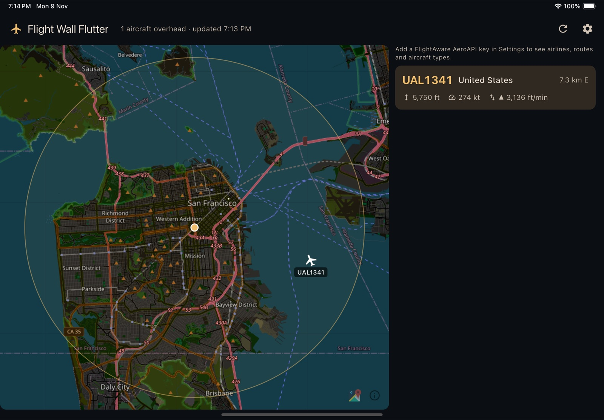

# Flight Wall Flutter

A wall-mountable tablet display that shows the aircraft flying over your home,
live. A dark map shows each plane at its position and heading, and a list
beside it shows the flights closest-first with their altitude, speed and
climb rate. Add a FlightAware key to see airline, route and aircraft type too.



This is an unofficial companion to
[TheFlightWall](https://github.com/AxisNimble/TheFlightWall_OSS), an ESP32 LED
wall. It uses the same data sources and its data logic is ported from that
project's firmware, but a tablet screen has room for far more detail than an
LED matrix. If you'd rather have the LED wall, see their
[open-source build](https://github.com/AxisNimble/TheFlightWall_OSS) or the
[official product](https://theflightwall.com).

## Features

- **Live map** of your area with each aircraft drawn at its position and heading
  and labelled with its flight number.
- **Flight cards** showing flight number, airline, origin → destination with
  city names, aircraft type, altitude, speed, vertical rate, and distance and
  direction from you.
- **Tap** a plane or a card to highlight it in both places.
- **Built for the wall:** locked to landscape, dark theme, screen kept awake,
  and polling pauses while the app is in the background.
- **Works without API keys.** OpenSky is used anonymously by default. Keys are
  optional and stay on the device.

## Getting started

You'll need [Flutter](https://docs.flutter.dev/get-started/install) 3.27 or
newer (Dart 3.6+) and an iPad or Android tablet, or a simulator/emulator.

```bash
git clone https://github.com/b5stephen/flightwall_flutter.git
cd flightwall_flutter
flutter pub get
cd app && flutter run
```

On first launch the app opens Settings. Enter your latitude and longitude, pick
a radius (2–50 km), and save.

> **iOS note:** debug builds only run while attached to `flutter run`. Opened
> from the home screen they quit immediately. For a tablet that runs the app on
> its own, install a release build on the device (`flutter run --release`).

### API keys (optional)

Both are entered in the app's Settings screen and stored in the device's secure
keystore (Keychain on iOS, Keystore-backed storage on Android). They're only
ever sent to OpenSky and FlightAware.

| Key | What it adds | Where to get it |
|---|---|---|
| **OpenSky API client** (client ID + secret) | Refreshes every 30 s instead of 90 s, with a higher daily limit | [opensky-network.org](https://opensky-network.org) → Account → API client |
| **FlightAware AeroAPI key** | Airline, route (origin/destination) and aircraft type | [flightaware.com/aeroapi](https://www.flightaware.com/commercial/aeroapi/) |

AeroAPI charges per request. To keep costs down, each aircraft is looked up once
and the result is reused for 30 minutes while it stays in range, so a large
radius over a busy airport will still use more lookups than a small one.

## How it works

```
packages/flightwall_core/   Pure Dart data layer (no Flutter): models, API clients, repository
app/                        Flutter tablet app (iOS + Android)
```

The two are linked with a [pub workspace](https://dart.dev/tools/pub/workspaces),
so one `flutter pub get` at the root sets up both.

Every poll, `FlightRepository` asks OpenSky for the aircraft inside a box around
your location, keeps those within your radius, and sorts them by distance. If an
AeroAPI key is set, it then looks up each callsign it hasn't seen recently. The
result is published on a `Stream`, and the app redraws from that.

`flightwall_core` has no Flutter dependency, so it can be reused in a
command-line tool or a server. Try it without any keys:

```bash
cd packages/flightwall_core
dart run example/main.dart 37.6213 -122.3790 25   # latitude longitude radiusKm
```

### Ported from TheFlightWall firmware

| Firmware (C++) | Dart |
|---|---|
| `OpenSkyFetcher` | `OpenSkySource` |
| `AeroAPIFetcher` | `AeroApiSource` |
| `FlightWallFetcher` | `FlightWallCdnNameSource` |
| `FlightDataFetcher` + `loop()` | `FlightRepository` |
| `GeoUtils.h` | `geo.dart` |

Changes from the firmware:

- **OpenSky works without keys.** The firmware requires OAuth credentials.
- **AeroAPI results are cached** per callsign for 30 minutes, including flights
  that weren't found. The firmware looks every plane up again on every poll.
- **The airborne flight is chosen.** AeroAPI returns several flights for a
  flight number. The firmware takes the first, which can be yesterday's or
  tomorrow's; this picks the one that has taken off and not yet landed.
- **More robust:** lookups run in parallel, one failed lookup doesn't fail the
  whole update, and TLS certificates are verified.

## Development

```bash
flutter pub get
(cd packages/flightwall_core && dart test && dart analyze)
(cd app && flutter test && flutter analyze)
```

The tests use fake HTTP responses and never call the real APIs.

## Data sources and limits

- **Aircraft positions:** [OpenSky Network](https://opensky-network.org).
  Check their terms of use before using the data beyond personal or research
  use.
- **Flight details:** [FlightAware AeroAPI](https://www.flightaware.com/commercial/aeroapi/),
  under your own account and its terms.
- **Airline and aircraft names:** `cdn.theflightwall.com`, TheFlightWall's
  lookup server, as used by their firmware. It isn't a documented public API
  and could change or go away.
- **Map tiles:** [OpenStreetMap](https://www.openstreetmap.org/copyright).
  Their tile servers are fine for personal use, but under the
  [tile usage policy](https://operations.osmfoundation.org/policies/tiles/) a
  widely distributed build should switch to a commercial tile provider.

## Known limitations

- OpenSky data occasionally reports planes parked at airports without an
  altitude or "on ground" flag, and barometric altitude can read slightly
  negative near sea level.
- Tested on iPad (simulator) only so far. Android is set up but untested.
  There's no web build: browsers are likely to block direct calls to OpenSky
  and AeroAPI.

## Licence

Apache License 2.0. See [LICENSE](LICENSE) and [NOTICE](NOTICE).

This project includes code derived from
[TheFlightWall OSS](https://github.com/AxisNimble/TheFlightWall_OSS)
(Apache 2.0). It isn't affiliated with or endorsed by TheFlightWall.
